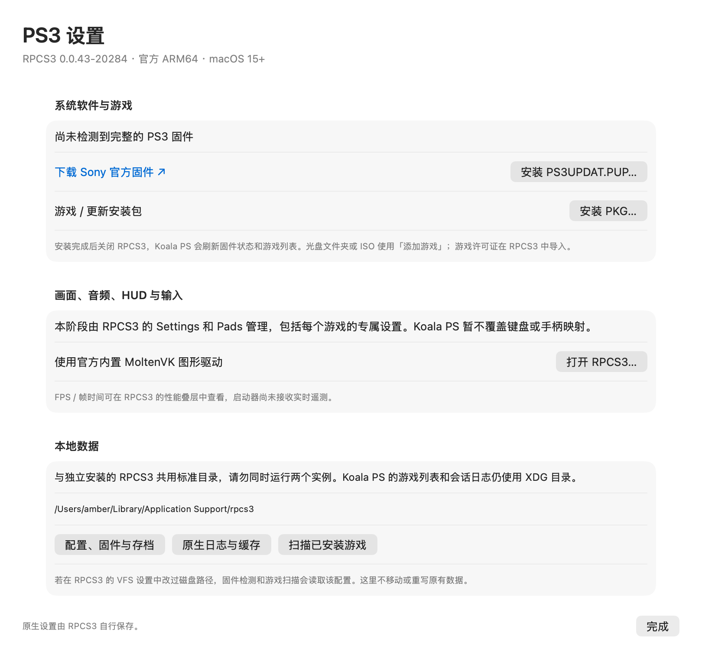

# Koala PS

面向 macOS 的原生 PSP / PS2 / PS3 模拟器：SwiftUI / AppKit 游戏库与设置界面，内置 PPSSPP 1.20.4 ARM64 引擎，Vulkan 经 MoltenVK 使用 Metal，SDL2 提供 PSP 原生输入与游戏窗口。PS2 集成官方 ARMSX2 ARM64 macOS 引擎（Qt/C++，默认 Metal），由独立进程运行。PS3 使用官方 RPCS3 ARM64 独立进程，保留原生设置与输入管理。

## PS3 预览 · 0.7.0-preview.2

[下载完整 macOS ARM64 ZIP](https://github.com/wzhzzmzzy/koalaps/releases/download/v0.7.0-preview.2/Koala-PSP-0.7.0-preview.2-macOS-arm64.zip) · [版本说明与校验和](https://github.com/wzhzzmzzy/koalaps/releases/tag/v0.7.0-preview.2)

本地 App：`dist/0.7.0-preview.2/Koala PSP.app`；完整分享包：`dist/Koala-PSP-0.7.0-preview.2-macOS-arm64.zip`。

PS3 需要 **Apple Silicon + macOS 15 或更新版本**；PSP / PS2 仍保留 macOS 14 最低要求。源码从当前提交重建可得到完整三平台应用，目标 Mac 不需要安装 RPCS3、Qt 或开发工具。

1. 在左侧选择 **PS3**，进入「PS3 设置」，通过 Sony 官方链接取得 `PS3UPDAT.PUP`，点击「安装固件」交给 RPCS3 校验、安装。
2. 游戏文件夹、ISO、EBOOT.BIN 可用「添加游戏」加入库；仅保存路径，不复制大镜像。文件夹会读取 PARAM.SFO 标题。安装包使用「安装 PKG」，所需的个人许可证由 RPCS3 管理。
3. 安装完成后关闭 RPCS3，启动器刷新固件状态和已安装游戏；也可以点击「扫描已安装游戏」。扫描只收录有可启动程序的 HDD 游戏，不把光盘更新数据列为独立游戏。
4. 开始游戏后，键盘、手柄使用 RPCS3 的 **Pads**，画质、音频、性能叠层和每游戏配置使用 RPCS3 原生界面。Koala PS 尚未接入统一映射、实时 HUD 或快捷存档，因此不会显示 PSP 的相应按钮或示意图。

固定官方版本为 **RPCS3 0.0.43-20284 / `2ba2f75bcea7ef6bdd687046c7fcfb790faf9853`**。完整官方 App（包括 Qt、MoltenVK 及资源）原样内置；Koala PS 不修改 PS3 模拟核心。启动时不设置全屏，使用官方内置图形运行库。退出使用 macOS 正常 Quit 请求，拒绝或超时后交由用户在原生窗口处理，不发送 SIGTERM / SIGKILL。



### PS3 数据位置

按用户选择，当前官方 macOS 引擎沿用自己的标准目录；它在 macOS 上忽略 XDG 配置/缓存变量。**会与单独安装的 RPCS3 共用数据**，应用在发现运行中的 RPCS3 时阻止重复启动，不自动迁移或改写已有配置。固件识别、游戏扫描读取引擎 VFS 中的自定义路径；不能理解的复杂 YAML 路径会明确提示。

| 内容 | 默认路径 |
| --- | --- |
| RPCS3 设置、输入、固件、游戏安装及存档 | `~/Library/Application Support/rpcs3/` |
| RPCS3 编译缓存及完整原生日志 | `~/Library/Caches/rpcs3/` |
| Koala PS 游戏库 | `~/.local/share/koala-psp/library.json` |
| Koala PS 每次 PS3 启动日志、退出时原生日志末尾副本 | `~/.local/state/koala-psp/sessions/ps3-*/` |

后续深度整合再迁移 PS3 到 XDG，并建立 Koala PS 统一输入模型。`PS3Engine.Launch` 负责启动意图，输入的唯一配置方目前明确为 RPCS3；不会维护两份互相覆盖的键位设置。`KOALA_DATA_DIR` 只隔离启动器测试数据，**不改变官方 RPCS3 的标准路径**。

### 本轮验证边界

已验证合成数据导入/边界校验、固件缺失拦截、安装参数、已安装游戏扫描、自定义 VFS 及配置保留、PSP/PS2/PS3 切换、离屏原生面板和官方 CLI 后台启动。已用用户提供的 PS3UPDAT.PUP 安装并检测到 **4.92 固件**。尚无 PS3 游戏，**未验证 PKG 安装、游戏启动、画面/音频、控制器、存档、正常游玩时的退出或 FPS**。官方无窗口安装器在文件写入成功后发生退出阶段异常；已独立核验安装成功日志、固件文件及后续启动，手工初始化推荐下面的原生界面方式。无前台激活，不测试全屏。签名仍为本地 ad-hoc，非 Developer ID 公证；第二台真机尚未测试。

## 下载与安装

当前预览版 **0.7.0-preview.2**，适用于 **Apple Silicon（M 系列）、macOS 14 及以上**；PS3 需要 macOS 15+。

完整 ZIP 可从上方链接下载，本地 App 位于上述 `dist/` 路径；所有发行包见 [Releases](https://github.com/wzhzzmzzy/koalaps/releases)。

1. 下载 ZIP 并解压，将 `Koala PSP.app` 拖入「应用程序」。
2. 打开应用，在左侧选择 PSP、PS2 或 PS3，点击「添加游戏」，选择本机游戏镜像。PS2 需要先在「PS2 设置」导入自己的 BIOS。
3. 点击开始游戏；镜像直接读取，不复制到应用、不上传。

ZIP 已包含完整应用、PPSSPP / ARMSX2 / RPCS3 引擎、Qt / SDL / MoltenVK 等依赖和图标，无需安装开发工具。可以将这个 ZIP 直接发给另一台符合要求的 Mac。游戏 ROM、BIOS、存档及个人设置不在包内，Intel Mac 不受支持。

目前为本地 ad-hoc 签名，尚未经过 Apple Developer ID 签名或公证。若首次打开提示无法验证开发者，确认文件来源与校验和后，可按 [Apple 说明](https://support.apple.com/zh-cn/102445) 在「系统设置 → 隐私与安全性」中允许打开。尚未在第二台物理 Mac 或 macOS 14 真机验证。

```sh
cd dist
shasum -a 256 -c Koala-PSP-0.7.0-preview.2-macOS-arm64.zip.sha256
```

## PSP 图形驱动

PSP 固定使用 **MoltenVK → Metal**，设置中显示运行路线，提供渲染分辨率、纹理、音频和 HUD 控制。已移除 KosmicKrisp 实验选择、加载分支、ICD / Loader 运行库和 SDK 下载步骤。旧偏好中的驱动字段自动删除，其他设置与游戏数据保留。

## 初始化 PS3 模拟器 · 每台设备做一次

**固件下载：[Sony 官方 PS3 系统软件页面](https://www.playstation.com/en-us/support/hardware/ps3/system-software/)。** 找到「Update using a computer」下的下载按钮，将文件保存为 `PS3UPDAT.PUP`，例如放在 `~/Downloads/`。固件直接从 Sony 下载；本仓库和应用 ZIP 不附带固件或其镜像，相关条款见 [Sony 系统软件许可](https://www.playstation.com/en-us/legal/ps3-system-software-license-agreement/)。

1. 安装并打开 Koala PS，在左侧选择 **PS3**，打开 **PS3 设置**。
2. 点击 **安装 PS3UPDAT.PUP…**，选择刚下载的文件。RPCS3 会打开原生安装确认窗口，确认安装后等待它报告完成；首次模块缓存准备可能需要一些时间。
3. 使用 RPCS3 菜单正常退出，回到 Koala PS。重新进入 PS3 设置应显示「已检测到 PS3 固件」及版本号，此时初始化完成。以后启动游戏无需反复下载或安装 PUP。
4. 尚未准备游戏时可以停在这里。固件负责系统初始化，游戏仍需另外添加；已有独立 RPCS3 安装并使用相同标准目录时，可以直接识别其固件。

本机 2026-10-13 已用用户提供的 **4.92** PUP 验证安装和识别；Sony 页面可能提供更新版本。初始化写入 `~/Library/Application Support/rpcs3/dev_flash/`（自定义 VFS 时以原生设置为准），不把固件写入 App。把 ZIP 发到另一台 Mac 后，应在那台设备重复以上初始化步骤。

## 如何运行 PS3 游戏

1. 打开应用并选择 **PS3 → PS3 设置 → 下载 Sony 官方固件**。在 Sony 页面下载 `PS3UPDAT.PUP`，回到应用点击「安装 PS3UPDAT.PUP」，等待 RPCS3 原生窗口报告完成。关闭 RPCS3 后，游戏库会刷新固件状态。
2. 准备游戏：光盘备份文件夹通常包含 `PS3_GAME/USRDIR/EBOOT.BIN`；可以直接用「添加游戏」选择整个游戏文件夹。ISO 也可以添加；加密镜像仍需对应的个人光盘密钥，解密/验证由 RPCS3 管理。
3. 数字版游戏通过 **PS3 设置 → 安装 PKG** 安装。若游戏需要 `.rap` / `.edat` 许可证，打开 RPCS3，在 **File → Install Packages/Raps/Edats** 中选择自己的许可证文件。关闭 RPCS3 后自动刷新，或点击「扫描已安装游戏」。
4. 选择游戏，点击「开始 PS3 游戏」。第一次启动会编译 PPU / SPU 代码和着色器，等待编译完成；缓存随后会复用。先采用原生默认配置，确认能进入游戏后再调整画质。
5. 在 RPCS3 工具栏 **Pads** 选择玩家、键盘或连接的手柄并保存。在原生 Settings / 每游戏设置中调整画质、音频与性能叠层。退出时先在游戏内保存进度，再关闭 RPCS3。

应用已经包含官方 RPCS3，无需再单独安装。最低为 Apple Silicon + macOS 15。当前尚无 PS3 游戏实测，游戏兼容性和性能需按具体游戏验证；参见 [RPCS3 官方兼容列表](https://rpcs3.net/compatibility) 与 [Sony 系统固件下载](https://www.playstation.com/en-us/support/hardware/ps3/system-software/)。

## PS2 接入范围

本版固定使用 [ARMSX2 nightly-20261008](https://github.com/ARMSX2/ARMSX2/releases/tag/nightly-20261008)，完整源码提交 `b1f3196b9ea6aa4e89907b02dffd63b784d13ed2`。主执行文件是 ARM64，不依赖 Rosetta。复用官方完整 macOS 二进制，不修改 PS2 核心、不将其称为本地源码构建；后续可替换为带控制桥接的同源引擎。默认配置由该官方引擎的 `-testconfig` 生成。

- PSP / PS2 游戏库分开显示，旧游戏记录自动归为 PSP；游戏文件仅保存路径，不复制或上传。
- 导入 BIOS 时检查 ROMDIR / ROMVER 结构，以 SHA-256 命名复制进私有目录，保留原件。错误文件不替换当前 BIOS；结构检查不等于实际启动认证。
- BIOS 是 PS2 主机的启动固件，与游戏 ISO 不同。应用不附带它；[提取指南](https://pcsx2.net/docs/setup/bios/) 也可从 PS2 设置打开。目前导入的是 BIOS 主文件，配套 ROM1/ROM2 等文件如需使用可通过原生引擎管理。
- 开始游戏、启动 BIOS 系统菜单、打开原生 ARMSX2 设置，以及正常退出请求。退出只发送一次 SIGTERM；按固定上游实现走正常退出流程，不升级为强制杀进程。
- 设置窗口提供 1×–4× 渲染倍率、音量和原生 HUD；修改保存在同一份引擎配置，下次启动生效。PS2 原始分辨率随游戏变化，示例尺寸不代表所有游戏的固定 720p / 1080p。
- 键盘/手柄示意图读取已保存的 ARMSX2 玩家 1 全局配置，支持重复绑定和组合键。它不是运行时内存快照；游戏专属覆盖、不常见按键和改键操作请使用 ARMSX2 的 Settings → Controllers。未配置的手柄会明确显示“未绑定”。
- 暂停、即时存档、去隔行、纹理与完整音频选项先使用 ARMSX2 原生菜单。PSP 专属快捷控制在 PS2 模式隐藏。PS2 实时遥测未接到启动器；游戏 FPS / 速度 / 帧时间由引擎 HUD 显示。

**验证边界：没有真实 PS2 BIOS 和游戏，尚未测试游戏启动、游玩、记忆卡、即时存档、音视频输出或 FPS。** 已验证配置启动、缺少 BIOS 的启动拦截、旧库兼容、配置保留、映射投影、离屏界面和完整 ZIP 移位启动。没有激活应用或测试全屏。当前应作为接入预览版使用。


### PS2 的 XDG 目录

继续沿用 `koala-psp` 应用标识以保留旧数据。以下路径也接受相应 XDG 环境变量：

| 目录 | 内容 |
| --- | --- |
| `~/.local/share/koala-psp/ps2/ARMSX2/` | BIOS、记忆卡、即时存档及游戏资源 |
| `~/.config/koala-psp/armsx2/` | PCSX2.ini、游戏专属设置、输入配置 |
| `~/.local/state/koala-psp/sessions/ps2-*/` | 每次引擎会话日志 |
| `~/.local/state/koala-psp/armsx2/` | 引擎其他日志 |
| `~/.cache/koala-psp/armsx2/` | 可重建缓存 |

上游 `-datapath` 自动附加 `ARMSX2` 子目录，`inis` 固定在该目录下；本应用只为这个位置建立指向 XDG config 的符号链接。目录已被不同内容占用时会报错并保留原件。不要在引擎运行中手动覆盖配置。

## PSP 功能

游戏库主 Logo 使用倾斜 18° 的原生矢量掌机图标，支持浅色与深色外观。


- 本机游戏库、开始/接续、暂停/继续、静音、保存并结束；自动与手动存档分开管理。
- 独立视频/画质、音频、HUD 设置弹窗；运行日志、截图与诊断导出。
- 原生键盘/手柄示意图，按模拟器实际生效配置显示绑定，支持组合键、清空和多个手柄设备。
- 运行时读取引擎内存映射，未保存改键与游戏专属配置也会同步；未运行时明确显示已保存的全局配置。
- 菜单快捷键：⌘O 添加游戏、⌘, 设置、⌘P 暂停、⌘S/⌘L 手动存档/读档、⇧⌘D 日志与调试。


手柄图按固定比例原生绘制；Xbox / PlayStation 选项只改变图示文字。点击按键或标注可查看完整绑定，「在模拟器中改键」打开实际设置页。PSP 没有原生右摇杆，但可以在模拟器中为它绑定其它动作。

SDL 的默认肩键编号与上游部分默认映射不同，可通过「为手柄 1 补齐 L/R 映射」添加别名，保留已有键盘和手柄绑定。实体手柄输入仍待真机验证。

键盘右侧的方向键为独立倒 T 布局，↑ 位于 ↓ 正上方，下排依次为 ←、↓、→；各键的动作仍读取实际配置。


### 画质、音频与 HUD

| 内部倍率 | 实际渲染尺寸 | 说明 |
| --- | --- | --- |
| 1× | 480 × 272 | PSP 原始分辨率 |
| 2× | 960 × 544 | 高度超过 480p |
| 3× | 1440 × 816 | 高度超过 720p |
| 4× | 1920 × 1088 | 接近 1080p，但不是 1920 × 1080 |

提供垂直同步、纹理过滤、各向异性过滤、智能 2D 过滤、跳帧、音频缓冲及音频间隙填补。大部分设置下次启动生效；静音、音量与 HUD 可立即调整。

HUD 展示 FPS、模拟速度、VBlank 平均间隔/P95 与内部渲染尺寸。VBlank 间隔和控制指令往返时间均不代表按键到屏幕的实测延迟。音频缓冲显示的是单块时长，也不是设备输出延迟。


## 本地数据与迁移

| 默认目录 | 内容 | 环境变量 |
| --- | --- | --- |
| `~/.config/koala-psp/` | 视频/音频/HUD 偏好与引擎配置 | `XDG_CONFIG_HOME` |
| `~/.local/share/koala-psp/` | 游戏库、记忆棒和游戏存档 | `XDG_DATA_HOME` |
| `~/.local/state/koala-psp/` | 最近游玩、运行日志和诊断 | `XDG_STATE_HOME` |
| `~/.cache/koala-psp/` | 可重建缓存 | `XDG_CACHE_HOME` |

有效的 `XDG_RUNTIME_DIR` 用于临时 IPC；缺失时采用 macOS 私有临时目录。环境变量须为绝对路径；Finder 启动通常不继承终端 `.zshrc`。测试可使用 `KOALA_DATA_DIR` 将所有状态隔离到一个本地目录。

首次启动保留原件地迁移旧版 `~/Library/Application Support/KoalaPSPNative` 数据，不覆盖目标已有文件。跨设备存档需要单独传输；游戏库保存的是本机路径，在新设备上需重新选择游戏镜像。

## 构建应用

需要 Apple Silicon Mac、Xcode Command Line Tools、CMake、7-Zip（`7zz`）和 Python 3.9+。已验证工具环境为 macOS 26.2 / M3 Pro、Swift 6.3.3、CMake 4.3。

```sh
git clone https://github.com/wzhzzmzzy/koala-ppsspp.git
cd koala-ppsspp
bash build.sh
```

`build.sh` 调用 `scripts/prepare-engine.sh`，从官方仓库获取 [upstream.json](upstream.json) 固定的 PPSSPP `v1.20.4` / `fa50bb1976065c4f8b1b47af227d367fe9771555` 及子模块到 `vendor/ppsspp`；随后应用 [引擎补丁](patches/ppsspp-native.patch)，复制两个桥接头文件，构建 ARM64 引擎和原生界面，生成 `.app`、本地签名和 ZIP。

PS3 打包运行 `scripts/prepare-ps3.py`，下载 [rpcs3-upstream.json](rpcs3-upstream.json) 固定的官方 7z 文件并核验 SHA-256、ARM64 与签名。不编译 RPCS3；对应源码与官方构建脚本的固定链接随包提供。

PS2 打包阶段运行 `scripts/prepare-ps2.py`，按 [armsx2-upstream.json](armsx2-upstream.json) 下载官方 macOS 包并校验固定 SHA-256；所有内置库保留在 helper bundle 内。PS2 无需 Qt 开发工具，也不会编译官方 PS2 源码。若要自行编译，使用同提交的 `.github/workflows/macos_build.yml` 及依赖脚本。

已有该固定版本的独立 PPSSPP 引擎 checkout 时，可以指定：

```sh
PPSSPP_SOURCE_DIR=/absolute/path/to/ppsspp bash build.sh
```

该目录会应用补丁并生成构建文件；版本不符会报错，不会自动重置已有 checkout。构建结果为 `dist/0.7.0-preview.2/Koala PSP.app` 和 `dist/Koala-PSP-0.7.0-preview.2-macOS-arm64.zip`，构建记录在 `output/build.json`。重新构建会替换本机 ZIP，随仓库提供的校验和只对应已发布的原始 ZIP。

目录说明：`Sources/` 为原生 UI 和桥接；`patches/` 为引擎修改；`Assets/` 为 App 图标；`scripts/` 为打包/审计/测试工具；`tests/` 为存储和映射测试。`vendor/`、`output/` 与私有测试 `data/` 均不提交。

## 验证

```sh
mkdir -p output
xcrun swiftc -parse-as-library Sources/AppStorage.swift Sources/PlayerPreferences.swift Sources/VulkanDriver.swift tests/StorageTests.swift \
  -o output/storage-tests -module-cache-path output/swift-module-cache
output/storage-tests
xcrun swiftc -parse-as-library Sources/InputMapping.swift tests/MappingTests.swift \
  -o output/mapping-tests -module-cache-path output/swift-module-cache
output/mapping-tests
xcrun swiftc -parse-as-library Sources/AppStorage.swift Sources/PS2Engine.swift Sources/PS2Mappings.swift Sources/InputMapping.swift tests/PS2Tests.swift \
  -o output/ps2-tests -module-cache-path output/swift-module-cache
output/ps2-tests Assets/ARMSX2-defaults.ini
xcrun swiftc -parse-as-library Sources/PlayerPreferences.swift Sources/VulkanDriver.swift tests/VulkanDriverTests.swift \
  -o output/vulkan-driver-tests -module-cache-path output/swift-module-cache
output/vulkan-driver-tests
# 完成构建后，核验依赖、签名、ZIP 移位与无窗口启动。
python3 scripts/audit-package.py
```

离屏预览不显示或激活窗口：

```sh
KOALA_DATA_DIR="$PWD/output/preview-data" \
  'dist/0.7.0-preview.2/Koala PSP.app/Contents/MacOS/KoalaPSP' --render-previews "$PWD/output/previews"
xcrun swift -module-cache-path output/swift-module-cache \
  scripts/check-controller-geometry.swift output/previews
```

后台集成测试需要自己提供匹配的游戏和游戏内存档，不随仓库分发：

```sh
xcrun swiftc scripts/check-background.swift -o output/check-background \
  -module-cache-path output/swift-module-cache
python3 scripts/test-background.py --rom /absolute/path/game.iso --state /absolute/path/in-game.ppst
```

不需要商业游戏的 MoltenVK 烟雾测试（cube 来自固定 PPSSPP 子模块）：

```sh
python3 scripts/test-vulkan.py --rom vendor/ppsspp/pspautotests/demos/cube.iso
```

以上游戏集成测试仅适用于 PSP。该测试使用隐藏引擎窗口和独立状态目录，验证设置、HUD、暂停/恢复、存档、实时改键及组合键。它不会测试全屏。前台实体手柄、长期稳定性和其它 Mac 尚未验证。

既有 M3 Pro 前台短时样本：同一《战神：奥林匹斯之链》第一关场景中，1× 平均约 58.9 FPS、3× 约 59.4 FPS，各采样 30 秒；存在短时掉帧，不代表通关或所有游戏的性能。后台/遮挡状态可能受 Metal 呈现等待影响。0.4.1–0.4.2 的图示修正没有重新执行游戏性能测试。

PS2 无 BIOS 的后台检查（不会创建窗口）：

```sh
xcrun swiftc scripts/check-ps2-background.swift -o output/check-ps2-background \
  -module-cache-path output/swift-module-cache
output/check-ps2-background "$PWD/dist/0.7.0-preview.2/Koala PSP.app" "$PWD/output/ps2-background-check"
KOALA_DATA_DIR="$PWD/output/ps2-preview-data" \
  'dist/0.7.0-preview.2/Koala PSP.app/Contents/MacOS/KoalaPSP' --render-previews "$PWD/output/ps2-previews" --ps2
```

PS3 无游戏的测试：

```sh
xcrun swiftc -parse-as-library Sources/AppStorage.swift Sources/PS3Engine.swift tests/PS3Tests.swift \
  -o output/ps3-tests -module-cache-path output/swift-module-cache
output/ps3-tests
xcrun swiftc scripts/check-ps3-background.swift -o output/check-ps3-background \
  -module-cache-path output/swift-module-cache
output/check-ps3-background "$PWD/dist/0.7.0-preview.2/Koala PSP.app" "$PWD/output/ps3-background-check"
```

后台检查使用 RPCS3 的 `--headless --version/--help`，会更新其标准缓存中的启动日志；如已运行 RPCS3，会先退出测试而不干扰已有会话。`--ps3-report` 只读状态，不启动引擎。测试没有模拟 PS3 游戏。

## 上游与许可

PPSSPP 核心及其修改依据上游 GPL-2.0-or-later 发布，原始完整声明见 [PPSSPP 许可](licenses/PPSSPP-LICENSE.txt)。固定的上游源码、全部引擎补丁和两个附加头文件均有明确构建入口。SDL2 的声明见 [SDL2 许可](licenses/SDL2-License.txt)；其他上游组件保留各自许可，随固定版本的源码/子模块获取。App 图标由 `scripts/make-icon.swift` 原生绘制。

ARMSX2 按 [GPL-3.0-or-later](licenses/ARMSX2-GPLv3.txt) 分发；[对应源码](https://github.com/ARMSX2/ARMSX2/tree/b1f3196b9ea6aa4e89907b02dffd63b784d13ed2)、[完整源码下载](https://github.com/ARMSX2/ARMSX2/archive/b1f3196b9ea6aa4e89907b02dffd63b784d13ed2.tar.gz) 和同版本 macOS 构建脚本可用于重建上游。完整第三方声明保留在 `Contents/Helpers/ARMSX2.app/Contents/Resources/docs/ThirdPartyLicenses.html`；应用还内置 GPL 文本、来源说明和固定版本清单。

本仓库不提供游戏 ROM、BIOS 或游戏存档。测试 BIOS 为程序生成的空数据与 ROMDIR 元信息，不含固件代码、不能启动，不进入发行包。

RPCS3 按 [GPL-2.0-only 及文件内例外声明](licenses/RPCS3-LICENSE.txt) 分发；固定来源、下载哈希和对应源码见 [rpcs3-upstream.json](rpcs3-upstream.json)。完整官方依赖、资源和许可保留在 helper bundle 中，来源说明位于 `Contents/Resources/Licenses/RPCS3-SOURCE.txt`。
