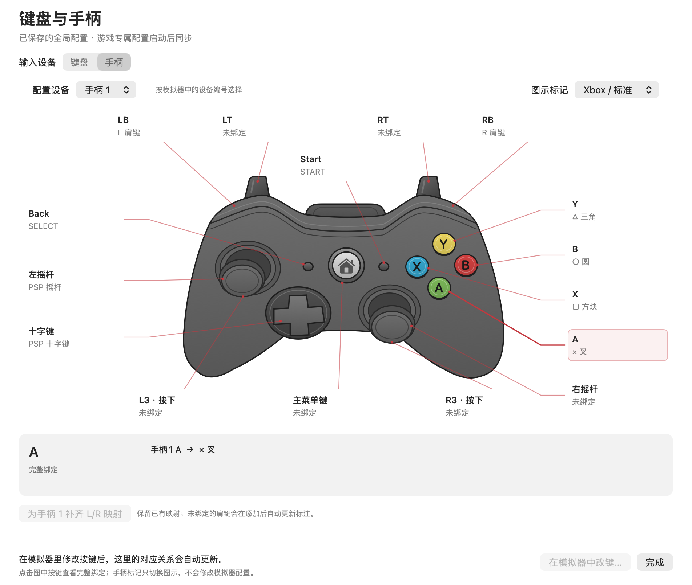
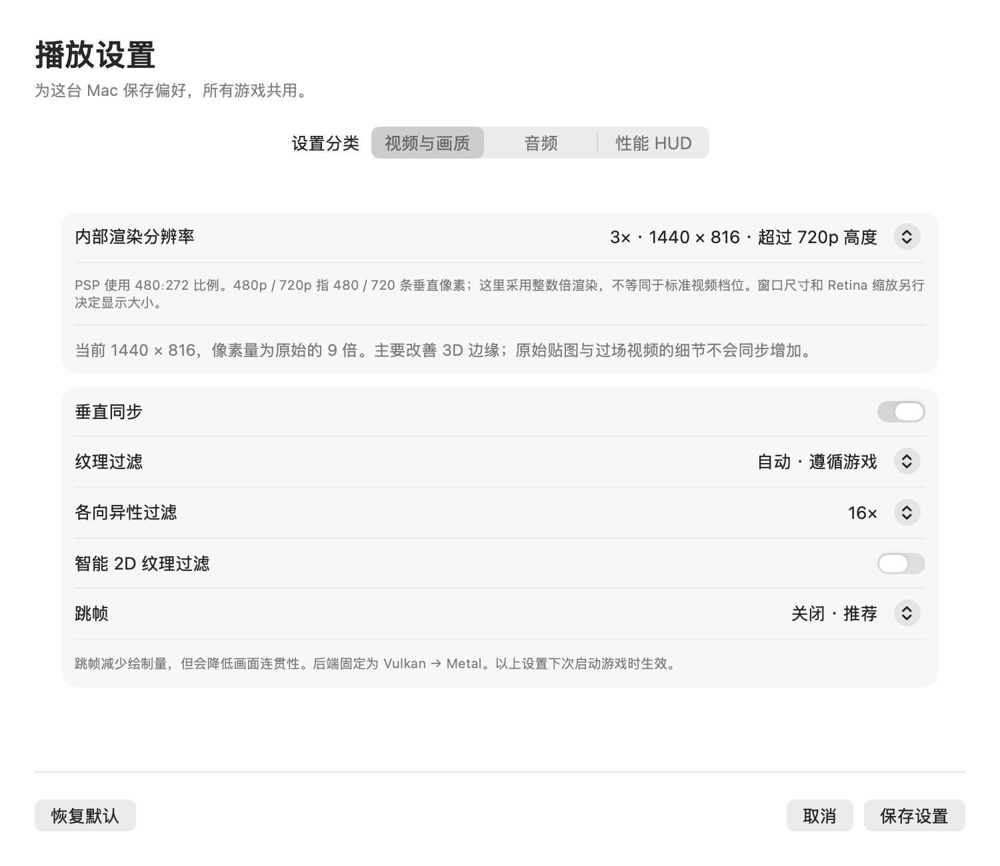

# Koala PSP

面向 macOS 的原生 PSP 播放器：SwiftUI / AppKit 游戏库与设置界面，内置 PPSSPP 1.20.4 ARM64 引擎，Vulkan 经 MoltenVK 使用 Metal，SDL2 提供原生输入与游戏窗口。不使用 WebView、Electron、JavaScript 或 WebAssembly。

## 下载与安装

当前版本 **0.4.1**，适用于 **Apple Silicon（M 系列）、macOS 14 及以上**。

**[下载 Koala-PSP-0.4.1-macOS-arm64.zip](https://github.com/wzhzzmzzy/koala-ppsspp/raw/refs/heads/main/dist/Koala-PSP-0.4.1-macOS-arm64.zip)** · [SHA-256](dist/SHA256SUMS)

1. 下载 ZIP 并解压，将 `Koala PSP.app` 拖入「应用程序」。
2. 打开应用，点击「添加游戏」，选择本机游戏镜像。
3. 点击开始游戏；镜像直接读取，不复制到应用、不上传。

ZIP 已包含完整应用、模拟器、SDL2、MoltenVK 和图标，无需安装开发工具。可以将这个 ZIP 直接发给另一台符合要求的 Mac。游戏 ROM、BIOS、存档及个人设置不在包内，Intel Mac 不受支持。

目前为本地 ad-hoc 签名，尚未经过 Apple Developer ID 签名或公证。若首次打开提示无法验证开发者，确认文件来源与校验和后，可按 [Apple 说明](https://support.apple.com/zh-cn/102445) 在「系统设置 → 隐私与安全性」中允许打开。尚未在第二台物理 Mac 或 macOS 14 真机验证。

```sh
cd dist
shasum -a 256 -c SHA256SUMS
```

## 功能

- 本机游戏库、开始/接续、暂停/继续、静音、保存并结束；自动与手动存档分开管理。
- 独立视频/画质、音频、HUD 设置弹窗；运行日志、截图与诊断导出。
- 原生键盘/手柄示意图，按模拟器实际生效配置显示绑定，支持组合键、清空和多个手柄设备。
- 运行时读取引擎内存映射，未保存改键与游戏专属配置也会同步；未运行时明确显示已保存的全局配置。
- 菜单快捷键：⌘O 添加游戏、⌘, 设置、⌘P 暂停、⌘S/⌘L 手动存档/读档、⇧⌘D 日志与调试。



手柄图按固定比例原生绘制；Xbox / PlayStation 选项只改变图示文字。点击按键或标注可查看完整绑定，「在模拟器中改键」打开实际设置页。PSP 没有原生右摇杆，但可以在模拟器中为它绑定其它动作。

SDL 的默认肩键编号与上游部分默认映射不同，可通过「为手柄 1 补齐 L/R 映射」添加别名，保留已有键盘和手柄绑定。实体手柄输入仍待真机验证。

### 画质、音频与 HUD

| 内部倍率 | 实际渲染尺寸 | 说明 |
| --- | --- | --- |
| 1× | 480 × 272 | PSP 原始分辨率 |
| 2× | 960 × 544 | 高度超过 480p |
| 3× | 1440 × 816 | 高度超过 720p |
| 4× | 1920 × 1088 | 接近 1080p，但不是 1920 × 1080 |

提供垂直同步、纹理过滤、各向异性过滤、智能 2D 过滤、跳帧、音频缓冲及音频间隙填补。大部分设置下次启动生效；静音、音量与 HUD 可立即调整。

HUD 展示 FPS、模拟速度、VBlank 平均间隔/P95 与内部渲染尺寸。VBlank 间隔和控制指令往返时间均不代表按键到屏幕的实测延迟。音频缓冲显示的是单块时长，也不是设备输出延迟。



## 本地数据与迁移

| 默认目录 | 内容 | 环境变量 |
| --- | --- | --- |
| `~/.config/koala-psp/` | 视频/音频/HUD 偏好与引擎配置 | `XDG_CONFIG_HOME` |
| `~/.local/share/koala-psp/` | 游戏库、记忆棒和游戏存档 | `XDG_DATA_HOME` |
| `~/.local/state/koala-psp/` | 最近游玩、运行日志和诊断 | `XDG_STATE_HOME` |
| `~/.cache/koala-psp/` | 可重建缓存 | `XDG_CACHE_HOME` |

有效的 `XDG_RUNTIME_DIR` 用于临时 IPC；缺失时采用 macOS 私有临时目录。环境变量须为绝对路径；Finder 启动通常不继承终端 `.zshrc`。测试可使用 `KOALA_DATA_DIR` 将所有状态隔离到一个本地目录。

首次启动保留原件地迁移旧版 `~/Library/Application Support/KoalaPSPNative` 数据，不覆盖目标已有文件。跨设备存档需要单独传输；游戏库保存的是本机路径，在新设备上需重新选择游戏镜像。

## 从源码构建

需要 Apple Silicon Mac、Xcode Command Line Tools、CMake 和 Python 3.9+。已验证工具环境为 macOS 26.2 / M3 Pro、Swift 6.3.3、CMake 4.3。

```sh
git clone https://github.com/wzhzzmzzy/koala-ppsspp.git
cd koala-ppsspp
bash build.sh
```

`build.sh` 调用 `scripts/prepare-engine.sh`，从官方仓库获取 [upstream.json](upstream.json) 固定的 PPSSPP `v1.20.4` / `fa50bb1976065c4f8b1b47af227d367fe9771555` 及子模块到 `vendor/ppsspp`；随后应用 [引擎补丁](patches/ppsspp-native.patch)，复制两个桥接头文件，构建 ARM64 引擎和原生界面，生成 `.app`、本地签名和 ZIP。

已有该固定版本的独立引擎 checkout 时，可以指定：

```sh
PPSSPP_SOURCE_DIR=/absolute/path/to/ppsspp bash build.sh
```

该目录会应用补丁并生成构建文件；版本不符会报错，不会自动重置已有 checkout。构建结果为 `dist/0.4.1/Koala PSP.app` 和 `dist/Koala-PSP-0.4.1-macOS-arm64.zip`，构建记录在 `output/build.json`。重新构建会替换本机 ZIP，随仓库提供的校验和只对应已发布的原始 ZIP。

目录说明：`Sources/` 为原生 UI 和桥接；`patches/` 为引擎修改；`Assets/` 为 App 图标；`scripts/` 为打包/审计/测试工具；`tests/` 为存储和映射测试。`vendor/`、`output/` 与私有测试 `data/` 均不提交。

## 验证

```sh
mkdir -p output
xcrun swiftc -parse-as-library Sources/AppStorage.swift Sources/PlayerPreferences.swift tests/StorageTests.swift \
  -o output/storage-tests -module-cache-path output/swift-module-cache
output/storage-tests
xcrun swiftc -parse-as-library Sources/InputMapping.swift tests/MappingTests.swift \
  -o output/mapping-tests -module-cache-path output/swift-module-cache
output/mapping-tests
# 完成构建后，核验依赖、签名、ZIP 移位与无窗口启动。
python3 scripts/audit-package.py
```

离屏预览不显示或激活窗口：

```sh
KOALA_DATA_DIR="$PWD/output/preview-data" \
  'dist/0.4.1/Koala PSP.app/Contents/MacOS/KoalaPSP' --render-previews "$PWD/output/previews"
xcrun swift -module-cache-path output/swift-module-cache \
  scripts/check-controller-geometry.swift output/previews
```

后台集成测试需要自己提供匹配的游戏和游戏内存档，不随仓库分发：

```sh
xcrun swiftc scripts/check-background.swift -o output/check-background \
  -module-cache-path output/swift-module-cache
python3 scripts/test-background.py --rom /absolute/path/game.iso --state /absolute/path/in-game.ppst
```

该测试使用隐藏引擎窗口和独立状态目录，验证设置、HUD、暂停/恢复、存档、实时改键及组合键。它不会测试全屏。前台实体手柄、长期稳定性和其它 Mac 尚未验证。

既有 M3 Pro 前台短时样本：同一《战神：奥林匹斯之链》第一关场景中，1× 平均约 58.9 FPS、3× 约 59.4 FPS，各采样 30 秒；存在短时掉帧，不代表通关或所有游戏的性能。后台/遮挡状态可能受 Metal 呈现等待影响。0.4.1 的图示修正没有重新执行游戏性能测试。

## 上游与许可

PPSSPP 核心及其修改依据上游 GPL-2.0-or-later 发布，原始完整声明见 [PPSSPP 许可](licenses/PPSSPP-LICENSE.txt)。固定的上游源码、全部引擎补丁和两个附加头文件均有明确构建入口。SDL2 的声明见 [SDL2 许可](licenses/SDL2-License.txt)；其他上游组件保留各自许可，随固定版本的源码/子模块获取。App 图标由 `scripts/make-icon.swift` 原生绘制。

本仓库不提供游戏 ROM、BIOS 或游戏存档。
