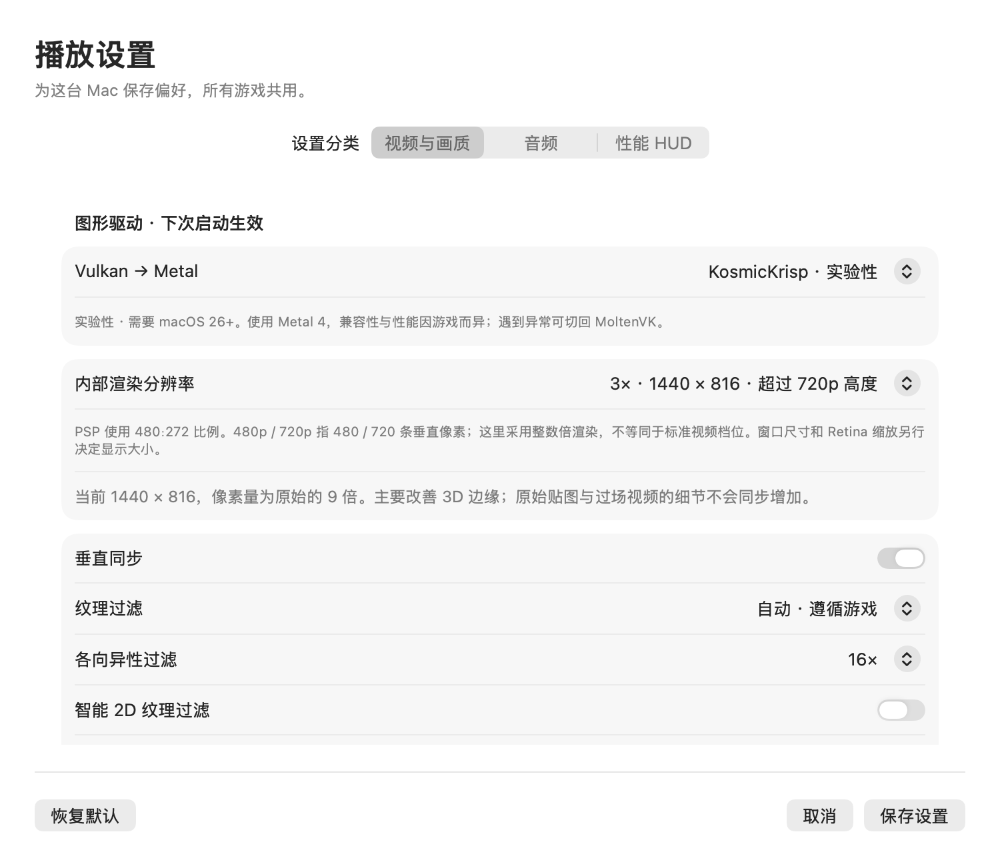
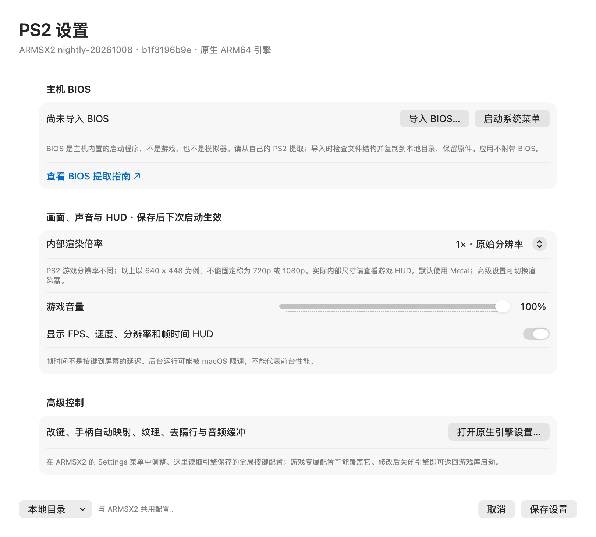
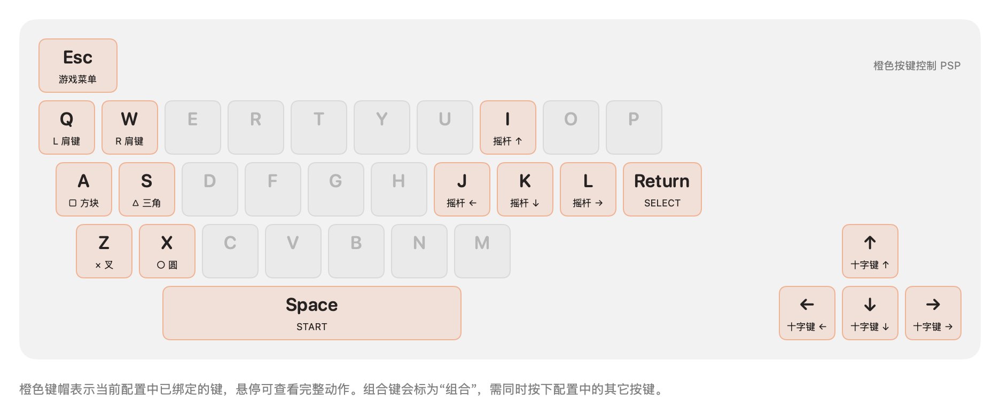

# Koala PS

面向 macOS 的原生 PSP / PS2 模拟器：SwiftUI / AppKit 游戏库与设置界面，内置 PPSSPP 1.20.4 ARM64 引擎，Vulkan 经 MoltenVK 使用 Metal，SDL2 提供 PSP 原生输入与游戏窗口。PS2 集成官方 ARMSX2 ARM64 macOS 引擎（Qt/C++，默认 Metal），由独立进程运行。

## 下载与安装

当前实验版 **0.6.0-experimental.1（KosmicKrisp 预览）**，适用于 **Apple Silicon（M 系列）、macOS 14 及以上**。

**[下载实验版 ZIP](https://github.com/wzhzzmzzy/koala-ppsspp/releases/download/v0.6.0-experimental.1/Koala-PSP-0.6.0-experimental.1-macOS-arm64.zip)** · [实验版发布说明](https://github.com/wzhzzmzzy/koala-ppsspp/releases/tag/v0.6.0-experimental.1) · [SHA-256](dist/SHA256SUMS)

1. 下载 ZIP 并解压，将 `Koala PSP.app` 拖入「应用程序」。
2. 打开应用，在左侧选择 PSP 或 PS2，点击「添加游戏」，选择本机游戏镜像。PS2 需要先在「PS2 设置」导入自己的 BIOS。
3. 点击开始游戏；镜像直接读取，不复制到应用、不上传。

ZIP 已包含完整应用、PPSSPP / ARMSX2 引擎、Qt / SDL / MoltenVK 等依赖和图标，无需安装开发工具。可以将这个 ZIP 直接发给另一台符合要求的 Mac。游戏 ROM、BIOS、存档及个人设置不在包内，Intel Mac 不受支持。

目前为本地 ad-hoc 签名，尚未经过 Apple Developer ID 签名或公证。若首次打开提示无法验证开发者，确认文件来源与校验和后，可按 [Apple 说明](https://support.apple.com/zh-cn/102445) 在「系统设置 → 隐私与安全性」中允许打开。尚未在第二台物理 Mac 或 macOS 14 真机验证。

```sh
cd dist
shasum -a 256 -c SHA256SUMS
```

## KosmicKrisp 实验选项

在 **PSP → 播放设置 → 视频与画质 → 图形驱动** 中选择 **KosmicKrisp · 实验性**，保存后重新启动游戏。默认仍是 MoltenVK；PS2 继续使用 ARMSX2 的 Metal 渲染器。

- KosmicKrisp 仅支持 **Apple Silicon + macOS 26 或更新版本**。旧系统禁用此选项；已有设置指向不支持的驱动时会明确报错，请手动切回 MoltenVK。
- 内置 Vulkan Loader **1.4.363** 和 KosmicKrisp **vulkan-sdk-1.4.363 / 269a955c89**，来源为 LunarG 官方 SDK **1.4.363.0**；用户无需安装 SDK。它通过 Metal 4 工作。
- 选择属于下一次启动配置。引擎分别加载内置库、限定 ICD 搜索、清除子进程继承的驱动/层覆盖；加载失败会报错，**不会悄悄回退到 OpenGL 或另一个驱动**。
- 存档、游戏库和键位保持共用；可重建缓存按 `~/.cache/koala-psp/vulkan/{moltenvk,kosmickrisp}/` 分开。Mesa 着色器缓存放在 KosmicKrisp 子目录。
- 「日志与调试」显示引擎实际返回的驱动名称、版本、Vulkan 版本和设备；诊断导出包含当前偏好及实际会话的驱动记录。刚保存的新选择不会冒充正在运行的驱动。
- 退回方法：结束游戏，把设置改回 MoltenVK，再启动；无需重装或删除存档。[0.5.1 完整旧版](https://github.com/wzhzzmzzy/koala-ppsspp/raw/refs/heads/main/dist/Koala-PSP-0.5.1-macOS-arm64.zip) 仍保留。

**验证范围：** macOS 26.2 / M3 Pro，PPSSPP 开源 cube 程序在两个驱动下均能后台渲染、截图、暂停/恢复及正常退出，截图已人工查看。无激活、无可见窗口、未测试全屏。缺失 ICD 的失败路径、偏好兼容与独立缓存、打包依赖/签名和 ZIP 移位均单独验证。用户原先的《战神》ISO 已不在原路径，本版尚未重新验证该商业游戏。没有前台 FPS 对比、长时间稳定性或第二台 Mac 的结果，**不宣称性能提升**。



## PS2 接入范围

本版固定使用 [ARMSX2 nightly-20261008](https://github.com/ARMSX2/ARMSX2/releases/tag/nightly-20261008)，完整源码提交 `b1f3196b9ea6aa4e89907b02dffd63b784d13ed2`。主执行文件是 ARM64，不依赖 Rosetta。复用官方完整 macOS 二进制，不修改 PS2 核心、不将其称为本地源码构建；后续可替换为带控制桥接的同源引擎。默认配置由该官方引擎的 `-testconfig` 生成。

- PSP / PS2 游戏库分开显示，旧游戏记录自动归为 PSP；游戏文件仅保存路径，不复制或上传。
- 导入 BIOS 时检查 ROMDIR / ROMVER 结构，以 SHA-256 命名复制进私有目录，保留原件。错误文件不替换当前 BIOS；结构检查不等于实际启动认证。
- BIOS 是 PS2 主机的启动固件，与游戏 ISO 不同。应用不附带它；[提取指南](https://pcsx2.net/docs/setup/bios/) 也可从 PS2 设置打开。目前导入的是 BIOS 主文件，配套 ROM1/ROM2 等文件如需使用可通过原生引擎管理。
- 开始游戏、启动 BIOS 系统菜单、打开原生 ARMSX2 设置，以及正常退出请求。退出只发送一次 SIGTERM；按固定上游实现走正常退出流程，不升级为强制杀进程。
- 设置窗口提供 1×–4× 渲染倍率、音量和原生 HUD；修改保存在同一份引擎配置，下次启动生效。PS2 原始分辨率随游戏变化，示例尺寸不代表所有游戏的固定 720p / 1080p。
- 键盘/手柄示意图读取已保存的 ARMSX2 玩家 1 全局配置，支持重复绑定和组合键。它不是运行时内存快照；游戏专属覆盖、不常见按键和改键操作请使用 ARMSX2 的 Settings → Controllers。未配置的手柄会明确显示“未绑定”。
- 暂停、即时存档、去隔行、纹理与完整音频选项先使用 ARMSX2 原生菜单。PSP 专属快捷控制在 PS2 模式隐藏。PS2 实时遥测未接到启动器；游戏 FPS / 速度 / 帧时间由引擎 HUD 显示。

**验证边界：没有真实 PS2 BIOS 和游戏，尚未测试游戏启动、游玩、记忆卡、即时存档、音视频输出或 FPS。** 已验证配置启动、缺少 BIOS 的启动拦截、旧库兼容、配置保留、映射投影、离屏界面和完整 ZIP 移位启动。没有激活应用或测试全屏。当前应作为接入预览版使用。



### PS2 的 XDG 目录

继续沿用 `koala-psp` 应用标识以保留旧数据。以下路径也接受相应 XDG 环境变量：

| 目录 | 内容 |
| --- | --- |
| `~/.local/share/koala-psp/ps2/ARMSX2/` | BIOS、记忆卡、即时存档及游戏资源 |
| `~/.config/koala-psp/armsx2/` | PCSX2.ini、游戏专属设置、输入配置 |
| `~/.local/state/koala-psp/sessions/ps2-*/` | 每次引擎会话日志 |
| `~/.local/state/koala-psp/armsx2/` | 引擎其他日志 |
| `~/.cache/koala-psp/armsx2/` | 可重建缓存 |

上游 `-datapath` 自动附加 `ARMSX2` 子目录，`inis` 固定在该目录下；本应用只为这个位置建立指向 XDG config 的符号链接。目录已被不同内容占用时会报错并保留原件。不要在引擎运行中手动覆盖配置。

## PSP 功能

游戏库主 Logo 使用倾斜 18° 的原生矢量掌机图标，支持浅色与深色外观。


- 本机游戏库、开始/接续、暂停/继续、静音、保存并结束；自动与手动存档分开管理。
- 独立视频/画质、音频、HUD 设置弹窗；运行日志、截图与诊断导出。
- 原生键盘/手柄示意图，按模拟器实际生效配置显示绑定，支持组合键、清空和多个手柄设备。
- 运行时读取引擎内存映射，未保存改键与游戏专属配置也会同步；未运行时明确显示已保存的全局配置。
- 菜单快捷键：⌘O 添加游戏、⌘, 设置、⌘P 暂停、⌘S/⌘L 手动存档/读档、⇧⌘D 日志与调试。


手柄图按固定比例原生绘制；Xbox / PlayStation 选项只改变图示文字。点击按键或标注可查看完整绑定，「在模拟器中改键」打开实际设置页。PSP 没有原生右摇杆，但可以在模拟器中为它绑定其它动作。

SDL 的默认肩键编号与上游部分默认映射不同，可通过「为手柄 1 补齐 L/R 映射」添加别名，保留已有键盘和手柄绑定。实体手柄输入仍待真机验证。

键盘右侧的方向键为独立倒 T 布局，↑ 位于 ↓ 正上方，下排依次为 ←、↓、→；各键的动作仍读取实际配置。



### 画质、音频与 HUD

| 内部倍率 | 实际渲染尺寸 | 说明 |
| --- | --- | --- |
| 1× | 480 × 272 | PSP 原始分辨率 |
| 2× | 960 × 544 | 高度超过 480p |
| 3× | 1440 × 816 | 高度超过 720p |
| 4× | 1920 × 1088 | 接近 1080p，但不是 1920 × 1080 |

提供垂直同步、纹理过滤、各向异性过滤、智能 2D 过滤、跳帧、音频缓冲及音频间隙填补。大部分设置下次启动生效；静音、音量与 HUD 可立即调整。

HUD 展示 FPS、模拟速度、VBlank 平均间隔/P95 与内部渲染尺寸。VBlank 间隔和控制指令往返时间均不代表按键到屏幕的实测延迟。音频缓冲显示的是单块时长，也不是设备输出延迟。


## 本地数据与迁移

| 默认目录 | 内容 | 环境变量 |
| --- | --- | --- |
| `~/.config/koala-psp/` | 视频/音频/HUD 偏好与引擎配置 | `XDG_CONFIG_HOME` |
| `~/.local/share/koala-psp/` | 游戏库、记忆棒和游戏存档 | `XDG_DATA_HOME` |
| `~/.local/state/koala-psp/` | 最近游玩、运行日志和诊断 | `XDG_STATE_HOME` |
| `~/.cache/koala-psp/` | 可重建缓存 | `XDG_CACHE_HOME` |

有效的 `XDG_RUNTIME_DIR` 用于临时 IPC；缺失时采用 macOS 私有临时目录。环境变量须为绝对路径；Finder 启动通常不继承终端 `.zshrc`。测试可使用 `KOALA_DATA_DIR` 将所有状态隔离到一个本地目录。

首次启动保留原件地迁移旧版 `~/Library/Application Support/KoalaPSPNative` 数据，不覆盖目标已有文件。跨设备存档需要单独传输；游戏库保存的是本机路径，在新设备上需重新选择游戏镜像。

## 构建应用

需要 Apple Silicon Mac、Xcode Command Line Tools、CMake 和 Python 3.9+。已验证工具环境为 macOS 26.2 / M3 Pro、Swift 6.3.3、CMake 4.3。

```sh
git clone https://github.com/wzhzzmzzy/koala-ppsspp.git
cd koala-ppsspp
bash build.sh
```

`build.sh` 调用 `scripts/prepare-engine.sh`，从官方仓库获取 [upstream.json](upstream.json) 固定的 PPSSPP `v1.20.4` / `fa50bb1976065c4f8b1b47af227d367fe9771555` 及子模块到 `vendor/ppsspp`；随后应用 [引擎补丁](patches/ppsspp-native.patch)，复制两个桥接头文件，构建 ARM64 引擎和原生界面，生成 `.app`、本地签名和 ZIP。

KosmicKrisp 打包运行 `scripts/prepare-vulkan.py`：按 [vulkan-upstream.json](vulkan-upstream.json) 校验官方下载及已解包库的 SHA-256，通过无窗口 `copy_only=1` 方式解包到 `vendor/vulkan-sdk`，不安装系统级驱动。仅两份运行库和相对路径 ICD 进入 App；相关许可证与源码版本同时内置。当前构建此实验包使用 macOS 26+。

PS2 打包阶段运行 `scripts/prepare-ps2.py`，按 [armsx2-upstream.json](armsx2-upstream.json) 下载官方 macOS 包并校验固定 SHA-256；所有内置库保留在 helper bundle 内。PS2 无需 Qt 开发工具，也不会编译官方 PS2 源码。若要自行编译，使用同提交的 `.github/workflows/macos_build.yml` 及依赖脚本。

已有该固定版本的独立 PPSSPP 引擎 checkout 时，可以指定：

```sh
PPSSPP_SOURCE_DIR=/absolute/path/to/ppsspp bash build.sh
```

该目录会应用补丁并生成构建文件；版本不符会报错，不会自动重置已有 checkout。构建结果为 `dist/0.6.0-experimental.1/Koala PSP.app` 和 `dist/Koala-PSP-0.6.0-experimental.1-macOS-arm64.zip`，构建记录在 `output/build.json`。重新构建会替换本机 ZIP，随仓库提供的校验和只对应已发布的原始 ZIP。

目录说明：`Sources/` 为原生 UI 和桥接；`patches/` 为引擎修改；`Assets/` 为 App 图标；`scripts/` 为打包/审计/测试工具；`tests/` 为存储和映射测试。`vendor/`、`output/` 与私有测试 `data/` 均不提交。

## 验证

```sh
mkdir -p output
xcrun swiftc -parse-as-library Sources/AppStorage.swift Sources/PlayerPreferences.swift Sources/VulkanDriver.swift tests/StorageTests.swift \
  -o output/storage-tests -module-cache-path output/swift-module-cache
output/storage-tests
xcrun swiftc -parse-as-library Sources/InputMapping.swift tests/MappingTests.swift \
  -o output/mapping-tests -module-cache-path output/swift-module-cache
output/mapping-tests
xcrun swiftc -parse-as-library Sources/AppStorage.swift Sources/PS2Engine.swift Sources/PS2Mappings.swift Sources/InputMapping.swift tests/PS2Tests.swift \
  -o output/ps2-tests -module-cache-path output/swift-module-cache
output/ps2-tests Assets/ARMSX2-defaults.ini
xcrun swiftc -parse-as-library Sources/PlayerPreferences.swift Sources/VulkanDriver.swift tests/VulkanDriverTests.swift \
  -o output/vulkan-driver-tests -module-cache-path output/swift-module-cache
output/vulkan-driver-tests
# 完成构建后，核验依赖、签名、ZIP 移位与无窗口启动。
python3 scripts/audit-package.py
```

离屏预览不显示或激活窗口：

```sh
KOALA_DATA_DIR="$PWD/output/preview-data" \
  'dist/0.6.0-experimental.1/Koala PSP.app/Contents/MacOS/KoalaPSP' --render-previews "$PWD/output/previews"
xcrun swift -module-cache-path output/swift-module-cache \
  scripts/check-controller-geometry.swift output/previews
```

后台集成测试需要自己提供匹配的游戏和游戏内存档，不随仓库分发：

```sh
xcrun swiftc scripts/check-background.swift -o output/check-background \
  -module-cache-path output/swift-module-cache
python3 scripts/test-background.py --rom /absolute/path/game.iso --state /absolute/path/in-game.ppst
```

不需要商业游戏的双驱动烟雾测试（cube 来自固定 PPSSPP 子模块）：

```sh
python3 scripts/test-vulkan.py --rom vendor/ppsspp/pspautotests/demos/cube.iso
python3 scripts/test-vulkan-failure.py
# 有自己的游戏与匹配存档时：
python3 scripts/test-background.py --driver kosmickrisp --rom /absolute/path/game.iso --state /absolute/path/in-game.ppst
```

以上游戏集成测试仅适用于 PSP。该测试使用隐藏引擎窗口和独立状态目录，验证设置、HUD、暂停/恢复、存档、实时改键及组合键。它不会测试全屏。前台实体手柄、长期稳定性和其它 Mac 尚未验证。

既有 M3 Pro 前台短时样本：同一《战神：奥林匹斯之链》第一关场景中，1× 平均约 58.9 FPS、3× 约 59.4 FPS，各采样 30 秒；存在短时掉帧，不代表通关或所有游戏的性能。后台/遮挡状态可能受 Metal 呈现等待影响。0.4.1–0.4.2 的图示修正没有重新执行游戏性能测试。

PS2 无 BIOS 的后台检查（不会创建窗口）：

```sh
xcrun swiftc scripts/check-ps2-background.swift -o output/check-ps2-background \
  -module-cache-path output/swift-module-cache
output/check-ps2-background "$PWD/dist/0.6.0-experimental.1/Koala PSP.app" "$PWD/output/ps2-background-check"
KOALA_DATA_DIR="$PWD/output/ps2-preview-data" \
  'dist/0.6.0-experimental.1/Koala PSP.app/Contents/MacOS/KoalaPSP' --render-previews "$PWD/output/ps2-previews" --ps2
```

## 上游与许可

PPSSPP 核心及其修改依据上游 GPL-2.0-or-later 发布，原始完整声明见 [PPSSPP 许可](licenses/PPSSPP-LICENSE.txt)。固定的上游源码、全部引擎补丁和两个附加头文件均有明确构建入口。SDL2 的声明见 [SDL2 许可](licenses/SDL2-License.txt)；其他上游组件保留各自许可，随固定版本的源码/子模块获取。App 图标由 `scripts/make-icon.swift` 原生绘制。

ARMSX2 按 [GPL-3.0-or-later](licenses/ARMSX2-GPLv3.txt) 分发；[对应源码](https://github.com/ARMSX2/ARMSX2/tree/b1f3196b9ea6aa4e89907b02dffd63b784d13ed2)、[完整源码下载](https://github.com/ARMSX2/ARMSX2/archive/b1f3196b9ea6aa4e89907b02dffd63b784d13ed2.tar.gz) 和同版本 macOS 构建脚本可用于重建上游。完整第三方声明保留在 `Contents/Helpers/ARMSX2.app/Contents/Resources/docs/ThirdPartyLicenses.html`；应用还内置 GPL 文本、来源说明和固定版本清单。

本仓库不提供游戏 ROM、BIOS 或游戏存档。测试 BIOS 为程序生成的空数据与 ROMDIR 元信息，不含固件代码、不能启动，不进入发行包。
